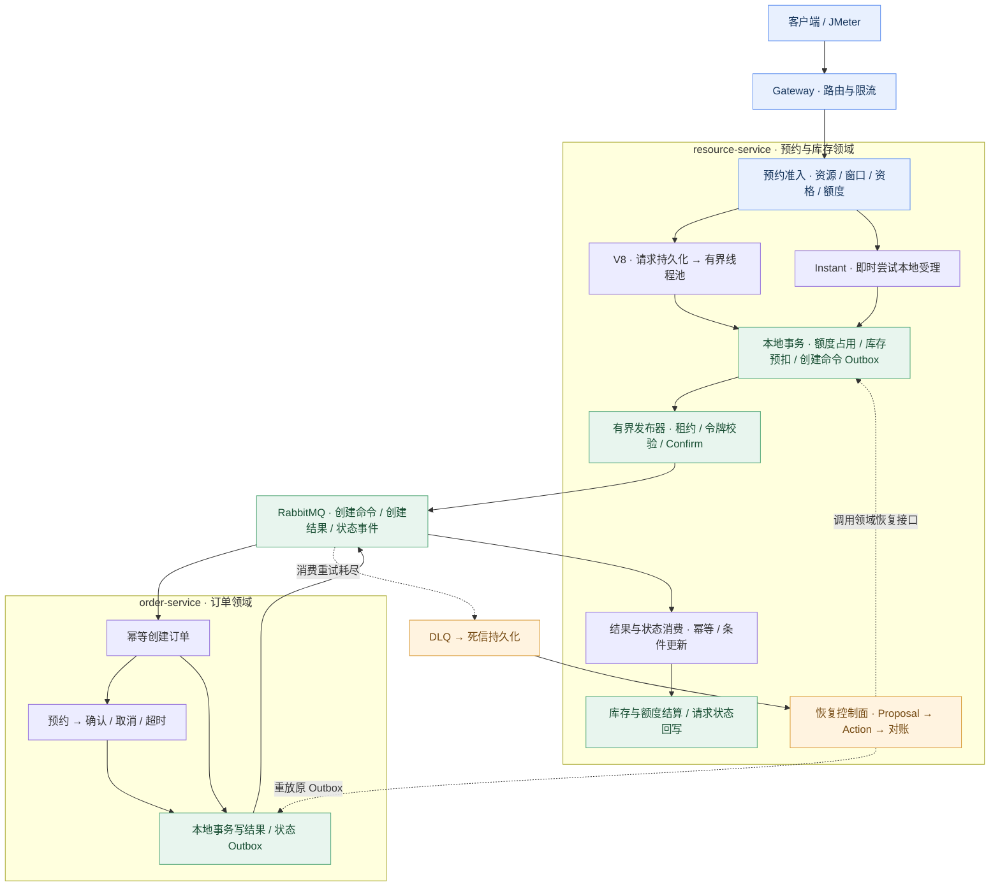

<h1 align="center">FlowOrder</h1>

<p align="center"><strong>高并发预约交易与履约一致性平台</strong></p>
<p align="center">从一次预约请求，到可追踪、可恢复的交易闭环。</p>

<p align="center">
  
  
  
  <a href="https://github.com/KunShengWang/FlowOrder/commits/main"></a>
</p>

<p align="center">
  <a href="#overview">项目介绍</a> ·
  <a href="#architecture">系统架构</a> ·
  <a href="#quick-start">快速开始</a> ·
  <a href="#evidence">验证证据</a> ·
  <a href="#docs">文档导航</a>
</p>

---

<a id="overview"></a>

## 项目介绍

FlowOrder 基于 **Java 17 + Spring Cloud Alibaba**，围绕有限库存资源的预约场景，实现预约准入、库存预扣、异步下单、订单履约和异常恢复。

项目关注高并发交易中几个具体问题：**重复请求如何只受理一次，跨服务失败后库存如何处理，消息积压如何定位，恢复动作如何避免重复执行。** 从分布式大锁到数据库条件更新，从同步下单到 Outbox 异步履约，每次演进都保留实现取舍和验证记录。

### 核心能力

| 能力 | 实现与设计重点 |
| :--- | :--- |
| **预约准入** | 校验资源状态、预约窗口、用户资格与限购额度；Redis Lua 快速准入，MySQL 条件更新与唯一索引兜底 |
| **双模式受理** | V8 先持久化、由有界线程池异步处理；Instant 在请求内尝试完成本地受理，明确返回受理、处理中或拒绝 |
| **可靠消息** | 本地事务写 Outbox；有界并发发布、在途数量限制、租约令牌校验；Confirm / Return、手动 ACK 与消费幂等 |
| **履约一致性** | 确认、取消、超时驱动库存和额度结算；通过条件状态转换与事件版本处理重复、乱序和迟到事件 |
| **受控恢复** | DLQ 持久化、不可变 Proposal、幂等 Action、执行租约与对账；无法确认的结果进入人工审核 |
| **工程验证** | JMeter、SQL 核对、针对性自动化测试；结合 MDC、Actuator、线程池及消息积压定位问题 |

> 当前仓库已包含 V7-lite / V8 / V9-lite / V10-core、OrderCare M0.5–M3、Instant 受理和 Outbox 并发发布。各项验证范围见[验证证据](#evidence)；生产身份认证、多节点容灾和完整容量验证仍需继续完善。

<a id="architecture"></a>

## 系统架构



MySQL 保存各领域的权威业务事实，Redis 承担快速准入和库存缓存。开发环境可共用 MySQL 实例，订单与库存仍由各自服务管理。V1 / V2 的同步 Feign 链路作为演进对照保留，未在图中展开。

### 两种受理模式

| 入口 | HTTP 返回语义 | 后续处理 |
| :--- | :--- | :--- |
| `POST /api/reservation/create/v8` | 返回已持久化请求的 `requestId` | 数据库租约抢占 + 有界线程池处理，客户端查询结果 |
| `POST /api/reservation/create/instant` | 返回 `ACCEPTED` / `PROCESSING` / `REJECTED` | 在请求内尝试提交库存、额度和 Outbox 本地事务，订单继续异步生成 |

**受理成功与订单履约是两个阶段。** Instant 的 `ACCEPTED` 表示本地受理事务已完成，不代表订单已经生成或确认；`PROCESSING` 表示结果仍需查询，不能据此释放库存或换一个 `requestId` 重试。

### 正确性约束

```text
total_stock = available_stock + locked_stock + sold_stock
available_stock >= 0    locked_stock >= 0    sold_stock >= 0
```

- **请求幂等**：相同 `requestId` 必须对应相同业务参数；唯一索引与条件更新控制重复副作用。
- **消息至少一次投递**：Broker ACK 且无 Return 才标记 Outbox 为 `SENT`；消费者通过 `messageId + consumerGroup` 和领域状态机承受重放。
- **事务边界**：业务数据与 Outbox 在同一本地事务提交，远程调用不放进数据库事务。
- **未知结果保留库存**：传输超时、提交结果未知与明确业务失败分开处理，无法自动确认时转 `MANUAL_REVIEW`。
- **终态不回退**：确认转 `SOLD`，取消或超时转 `RELEASED`；迟到的创建成功事件不能覆盖终态。

<details>
<summary><strong>展开：受控恢复如何处理重复执行与响应丢失</strong></summary>

恢复链路为：`inspect → Proposal → 审批 → execute → reconcile`。

- Proposal 固化版本、状态指纹、影响摘要与有效期；执行前重新检查业务状态，状态漂移后原审批失效。
- `proposalId` 表示审批对象，`actionRequestId` 表示副作用幂等键，两者一对一绑定。
- 活跃执行租约阻止第二执行者；响应丢失或租约过期后查询、对账或接管原 Action。
- `SUBMITTED` 表示恢复命令已提交，业务是否收敛由 `caseOutcome` 独立表达。
- 无法证明动作是否执行时转人工审核，不自动创建第二个恢复动作。

实现与实验见 [M2 受控恢复](docs/reports/ordercare/m2-controlled-recovery.md)和 [M3 执行租约与对账](docs/reports/ordercare/m3-action-reconciliation.md)。

</details>

## 技术选型与目录

| 层次 | 技术 | 用途 |
| :--- | :--- | :--- |
| 应用框架 | Java 17、Spring Boot 3.5.14 | 服务开发、本地事务与生命周期管理 |
| 服务治理 | Spring Cloud 2025.0.0、Spring Cloud Alibaba 2025.0.0.0 | Gateway、Nacos、OpenFeign、Sentinel |
| 数据与缓存 | MySQL 8、MyBatis Plus 3.5.15、Redis、Redisson 3.32.0 | 业务事实、条件更新、唯一约束、Lua 与历史锁方案 |
| 消息通信 | RabbitMQ、Spring AMQP | Outbox 发布、Confirm / Return、手动 ACK、DLQ |
| 验证与诊断 | JUnit、Mockito、JMeter、Actuator、MDC | 自动化回归、压力实验、指标与日志关联 |

```text
floworder
├── floworder-server/
│   ├── floworder-gateway-service/       # 统一入口、路由与限流
│   ├── floworder-resource-service/      # 准入、请求、库存、消息消费与恢复
│   └── floworder-order-service/         # 订单创建、履约状态机与订单侧 Outbox
├── floworder-server-client/             # Feign 契约、共享 DTO、消息协议
├── floworder-common/                    # 公共响应、异常、枚举与工具
├── floworder-spring-cloud-framework/    # 组合校验与服务公共基础设施
├── floworder-redisson-framework/        # Redisson 公共配置
├── sql/                                # 数据库结构、测试数据与迁移
├── jmeter/                             # 压测脚本
├── apifox/                             # OpenAPI 接口集合
├── scripts/ordercare/                   # 恢复实验与核对脚本
└── docs/                               # 架构、故障分析与验证记录
```

<a id="quick-start"></a>

## 快速开始

### 1. 准备环境

安装 JDK 17、Maven、MySQL 8、Redis、RabbitMQ 和 Nacos。先启动中间件，再启动应用服务。

```bash
git clone https://github.com/KunShengWang/FlowOrder.git
cd FlowOrder
```

在**独立测试库**中依次执行 [建表脚本](sql/floworder.sql)和[示例数据](sql/floworder_test_data.sql)。

> 建表脚本包含 `DROP TABLE`，示例数据也会清理固定 ID 的记录，仅用于初始化测试环境。已有数据库升级应检查对应迁移脚本，勿重跑建表脚本。

示例数据提供 `userId=1001`、`resourceId=1`、`stockItemId=1`，库存 10、用户额度 5，预约窗口与资格有效期为初始化时刻前 1 小时至后 1 天。

### 2. 配置与启动

检查三个服务的连接配置，替换为本地中间件地址与凭据：

- [resource-service 配置](floworder-server/floworder-resource-service/src/main/resources/application.yaml)：MySQL、Redis、Redisson、RabbitMQ、Nacos。
- [order-service 配置](floworder-server/floworder-order-service/src/main/resources/application.yaml)：MySQL、RabbitMQ、Nacos。
- [Gateway 配置](floworder-server/floworder-gateway-service/src/main/resources/application.yaml)与 [pro 路由](floworder-server/floworder-gateway-service/src/main/resources/application-pro.yaml)：Nacos 与网关路由，默认启用 `pro`。

Redis 与 Redisson 应使用一致的地址和逻辑库，服务使用一致的 RabbitMQ virtual host。恢复管理开关 `floworder.admin.enabled` 在仓库默认配置中为 `false`；它只是功能开关，生产认证与授权仍待完善。

```bash
mvn -DskipTests package
```

在三个终端依次运行：

```bash
java -jar floworder-server/floworder-order-service/target/floworder-order-service-0.0.1-SNAPSHOT.jar
java -jar floworder-server/floworder-resource-service/target/floworder-resource-service-0.0.1-SNAPSHOT.jar
java -jar floworder-server/floworder-gateway-service/target/floworder-gateway-service-0.0.1-SNAPSHOT.jar
```

也可以在 IDEA 中依次启动 `FloworderOrderServiceApplication`、`FloworderResourceServiceApplication`、`FloworderGatewayServiceApplication`。

| 服务 | 默认端口 | 检查方式 |
| :--- | :---: | :--- |
| Gateway | 8088 | `GET /actuator/health` |
| resource-service | 8081 | `GET /actuator/health` |
| order-service | 8082 | `GET /actuator/health` |
| Nacos | 8848 | 服务列表中检查三个应用是否注册 |
| RabbitMQ | 5672 | 检查业务队列、消费者与 DLQ |

### 3. 提交预约

推荐导入 [OpenAPI / Apifox 集合](apifox/floworder.openapi.json)，也可用 PowerShell 发起请求：

```powershell
$requestId = "demo-" + [guid]::NewGuid().ToString("N")
$body = @{
    userId = 1001
    resourceId = 1
    stockItemId = 1
    quantity = 1
    requestId = $requestId
} | ConvertTo-Json

Invoke-RestMethod -Method Post -Uri "http://127.0.0.1:8088/api/reservation/create/instant" -ContentType "application/json" -Body $body

# 异步订单生成需要时间；查询请求状态与订单结果
Invoke-RestMethod -Uri "http://127.0.0.1:8088/api/reservation/request/$requestId"
Invoke-RestMethod -Uri "http://127.0.0.1:8088/api/order/query?requestId=$requestId"
```

需要体验 V8 时，将提交地址改为 `/api/reservation/create/v8`。重试同一业务请求时保留原 `requestId` 和请求参数。

| 操作 | 接口 |
| :--- | :--- |
| 查询预约请求 | `GET /api/reservation/request/{requestId}` |
| 查询订单 | `GET /api/order/query?requestId=...` |
| 确认订单 | `POST /api/order/confirm`，请求体含 `orderNo`、`userId` |
| 取消订单 | `POST /api/order/cancel`，请求体含 `orderNo`、`userId`、`reason` |

<a id="evidence"></a>

## 验证证据

以下为**仓库中已记录的阶段实验**，不是本次文档更新重新执行的测试。验证结论限定在各报告的环境、负载和故障场景内。

| 场景 | 证据状态 | 已记录结果与入口 |
| :--- | :--- | :--- |
| V8 异步预约 | 已压测 | 100 线程、900 请求；平均 16 ms、HTTP 错误率 0%；请求、订单、预扣各 900 条，库存差值 0。[报告](docs/reports/v12/02-v8-jmeter-evidence.md) |
| Instant 热点库存 | 已压测 | 5,000 个唯一请求竞争 100 份库存，连续 5 轮；每轮 100 份受理 / 预扣 / 订单，无超卖或库存差异。[修复与复测摘要](docs/instant-duplicate-request-race-analysis.md) |
| Instant 并发幂等 | 已自动化测试、已压测 | 1,000 个 requestId 各并发提交 5 次，连续 5 轮；每轮最终形成 1,000 份业务结果，人工审核与业务丢失均为 0。[竞态分析](docs/instant-duplicate-request-race-analysis.md) |
| 订单结果消费扩容 | 已压测 | 修复长生命周期消费者在线程池中排队的问题；报告记录 40 / 50 req/s 下结果发布、消费与提交速率对齐，无启动超时。[分析](docs/order-result-listener-capacity-analysis.md) |
| 确认 / 取消 / 超时 | 已实现、已记录链路验证 | SQL 与 MQ 核对库存成交或释放、额度与请求状态收敛。[主链路](docs/reports/v12/01-main-flow-evidence.md) · [超时关闭](docs/reports/v12/04-timeout-close-evidence.md) |
| OrderCare M3 恢复 | 已自动化测试、已故障验证 | 报告记录恢复域 42 项测试通过，以及真实 MySQL / RabbitMQ E2E；重复对账复用原 Action。[报告](docs/reports/ordercare/m3-action-reconciliation.md) |

**如何理解这些数字：** HTTP 返回耗时与订单异步完成耗时需要分别测量。V8 历史短测的 91.4 req/s 不能当作系统容量上限；不同环境的实验也不能直接拼成性能提升比例。部分报告仅保留摘要，未随仓库发布的原始 benchmark 材料不视为已公开的可复验证据。

<details>
<summary><strong>展开：本地测试与核对</strong></summary>

准备好测试所需的中间件后，在独立测试环境运行：

```bash
mvn -pl floworder-server/floworder-resource-service,floworder-server/floworder-order-service -am test
```

测试中包含中间件依赖，环境要求以各测试类和实验脚本为准。压测结束后还需核对：

1. 请求、订单、预扣记录是否一一对应，相同请求是否产生重复业务结果。
2. MySQL 库存是否守恒、是否出现负数，Redis 是否与业务事实一致或按设计失效。
3. Outbox、消费日志、RabbitMQ 队列 / DLQ 是否收敛，有无残留的人工审核事项。
4. HTTP 吞吐与 P95 / P99、业务错误率、履约延迟、积压及恢复时间。

JMeter 正式压测应关闭 View Results Tree。只有 HTTP 200 或编译通过，不能证明业务正确性。

</details>

### 当前边界与后续验证

- **已实现**：Outbox 采用有界 worker、最大在途限制、租约令牌校验和持续补充任务的 dispatcher；每个 worker 内仍同步等待 Confirm。
- **计划验证**：继续补齐同环境的多版本容量对比、完整 P95 / P99 与履约延迟，以及多实例竞争、网络分区和中间件故障矩阵。
- **部署边界**：恢复接口目前面向受控实验环境；可信身份、生产授权和部署硬化尚未完成。Actuator 与结构化日志提供基础诊断，尚不代表完整生产监控平台。

<a id="docs"></a>

## 文档导航

| 阅读目标 | 文档 |
| :--- | :--- |
| 理解整体设计 | [系统架构与流程](docs/architecture/floworder-architecture.md) |
| 查看履约证据 | [确认与取消](docs/reports/v12/01-main-flow-evidence.md) · [超时关闭](docs/reports/v12/04-timeout-close-evidence.md) |
| 理解性能演进 | [Outbox 并发设计](docs/outbox-concurrent-publisher-design.md) · [调度容量分析](docs/outbox-dispatch-capacity-analysis.md) · [消费扩容排查](docs/order-result-listener-capacity-analysis.md) |
| 理解并发竞态 | [Instant 重复 requestId 修复与复测](docs/instant-duplicate-request-race-analysis.md) |
| 学习恢复闭环 | [M0.5 基线](docs/reports/ordercare/m0.5-recovery-baseline.md) · [M1 诊断](docs/reports/ordercare/m1-case-diagnosis.md) · [M2 受控恢复](docs/reports/ordercare/m2-controlled-recovery.md) · [M3 租约与对账](docs/reports/ordercare/m3-action-reconciliation.md) |
| 调试与复现 | [接口集合](apifox/floworder.openapi.json) · [JMeter](jmeter/) · [OrderCare 脚本](scripts/ordercare/) |
| 项目复盘与面试 | [讲解指南](docs/resume/floworder-interview-guide.md) · [简历素材](docs/resume/floworder-resume-points.md) |

设计文档保留当时的决策背景，可能包含历史方案和待测项；判断当前实现以源码为准，判断验证范围以对应实验记录为准。

<details>
<summary><strong>展开：版本演进脉络</strong></summary>

| 阶段 | 解决的问题 |
| :--- | :--- |
| V1 → V2 | 从分布式大锁转向 Redis Lua、MySQL 条件更新与幂等，明确同步调用的未知结果 |
| V3 → V4 | Outbox + RabbitMQ 异步下单，接通确认、取消、超时与库存结算 |
| V5 → V6 | 网关限流、熔断、线程隔离、优雅停机与日志关联 |
| V7-lite → V8 | 增加预约准入与限购；请求持久化、数据库租约和有界线程池 |
| V9-lite → V10-core | 增强履约事件处理与可预览、可审计的幂等恢复 |
| V12 | 随版本积累正确性、压力、故障与排查证据 |
| OrderCare M0.5–M3 | 诊断、不可变提案、受控执行与原 Action 对账 |
| Instant 与容量改造 | 明确即时受理语义，优化 Outbox 调度与消费者扩容，修复重复请求准入竞态 |

</details>

---

<p align="center">
  <a href="#overview">返回项目介绍 ↑</a>
</p>
